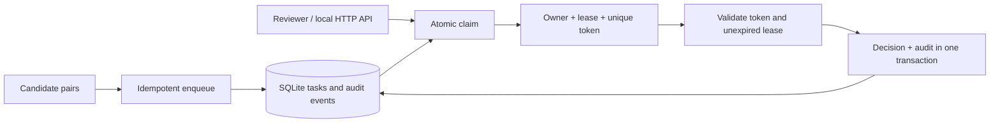

# Data review queue

**Two reviewers request the same work. One walks away. Who can safely finish the task?**

This project turns fictional duplicate-supplier candidates into a durable review workflow. Reviewers receive expiring claims; a fresh claim gets a fresh token, preventing an abandoned browser or worker from submitting a decision after work has been reassigned.

## Try it in one minute

Requires Python 3.9+ with SQLite. No packages or cloud services required.

```bash
python3 review_queue.py
python3 -m unittest discover -s tests -v
```

The demonstration claims the higher-priority supplier pair, records a `keep_separate` decision, and leaves the lower-priority task pending. Supplier names are invented. These decisions are review records; this service does not merge actual source-system records.

## Try the HTTP API

```bash
python3 api.py --db review-demo.db --port 8080
```

In another terminal:

```bash
curl -s http://127.0.0.1:8080/tasks -H 'Content-Type: application/json' \
  -d '{"id":"DEMO-001","payload":{"candidates":["Juniper Supply","Juniper Workshop Supply"]},"priority":90}'

curl -s http://127.0.0.1:8080/claims -H 'Content-Type: application/json' \
  -d '{"reviewer":"demo-reviewer","lease_seconds":300}'
```

Copy the returned claim token into the decision request before the lease expires:

```bash
curl -s http://127.0.0.1:8080/decisions -H 'Content-Type: application/json' \
  -d '{"id":"DEMO-001","reviewer":"demo-reviewer","token":"PASTE_CLAIM_TOKEN","decision":"keep_separate"}'

curl -s http://127.0.0.1:8080/tasks
```

The API binds only to `127.0.0.1`. Reviewer names are unverified demonstration inputs, not authenticated identities. The standard-library HTTP server is for local evaluation; do not expose it as a production service.

## Architecture



## Queue policy

| Rule | Behavior |
|---|---|
| Priority | Higher numeric value first; valid range 0–100. |
| Tie-break | Earlier creation time, then task ID. |
| Enqueue replay | Same ID and content is a no-op; conflicting content is rejected. |
| Atomic claim | `BEGIN IMMEDIATE` prevents competing writers from selecting the same eligible task. |
| Lease recovery | Expired claims become eligible without a separate cleanup process. |
| Fencing | Completion requires the exact current token, matching reviewer, and unexpired lease. |
| Completion | Decision and audit event commit together; completed tasks cannot be claimed again. |

Supported decisions are `merge`, `keep_separate`, and `needs_information`. All are final decisions for this queue entry; `needs_information` does not automatically reopen it.

## What the tests demonstrate

Real concurrent connections compete for one task; only one succeeds. Tests also cover priority/FIFO ordering, lease expiry, same-reviewer token replacement, wrong-owner completion, enqueue collisions, audit events, and a complete loopback HTTP lifecycle.

## Scope and provenance

This newly authored portfolio example is inspired by data-operations queue design experience. No employer source, business-specific ranking rules, customer records, internal configuration, or original history is included.

The queue has no identity provider, lease heartbeat, starvation prevention, payload search, or production monitoring. SQLite serializes writers; no distributed throughput claim is made. See [design notes](docs/design.md) and [verification](docs/verification.md).

## License

[MIT License](LICENSE) — Copyright (c) 2026 Shane Warnakula.
