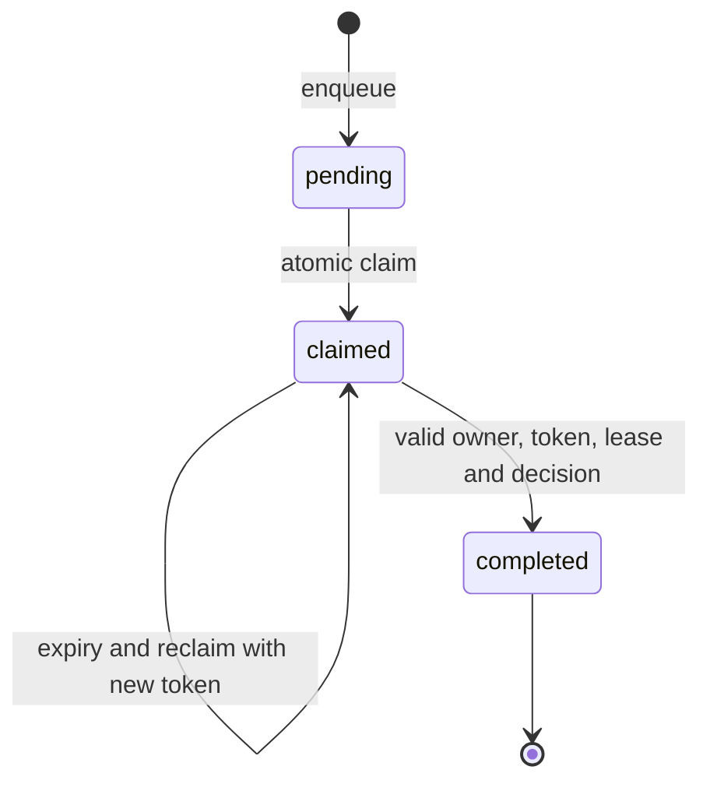

# Design notes: claims are temporary authority

## State machine

The lease determines whether a task is still owned. The token determines whether a completion belongs to this particular claim. Reviewer identity alone is insufficient: the same reviewer can return after a lease has expired and reacquire the same task.

## Storage boundary

Every mutation holds a short SQLite write transaction. Network requests do not run inside the claim transaction. Separate HTTP requests use separate connections. WAL permits readers alongside the single writer, but this is not a substitute for PostgreSQL row-level locking under substantial write concurrency.

## Known tradeoffs

High-priority work can starve low-priority work. A paused client must reclaim after expiry; leases cannot currently be extended. The queue records review decisions but does not execute source-system merges. An application would authenticate reviewers, authorize access to records, and submit approved mutations through a separate audited service.

Lease timestamps use the host clock. A multi-host deployment needs a shared time authority and explicit handling of clock changes. Task payloads have a size limit at the HTTP boundary but no domain-specific schema beyond being JSON-serializable.

## Extension path

Add authenticated identity, heartbeat/lease renewal, bounded attempts and escalation, fairness/aging, and PostgreSQL `SKIP LOCKED` claims. Preserve the concurrency and fencing tests when changing storage.

## Interview discussion

Walk through two reviewers claiming at once, then an old client completing after reassignment. Explain why atomic selection prevents the first race and fencing tokens prevent the second.
